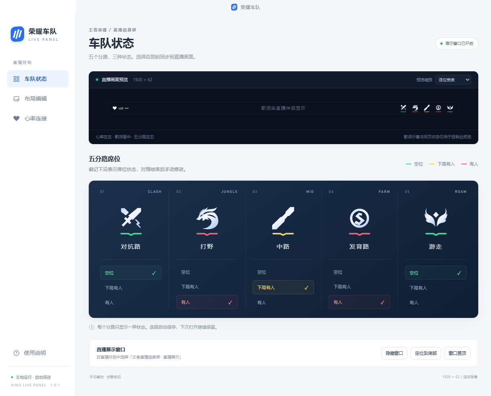
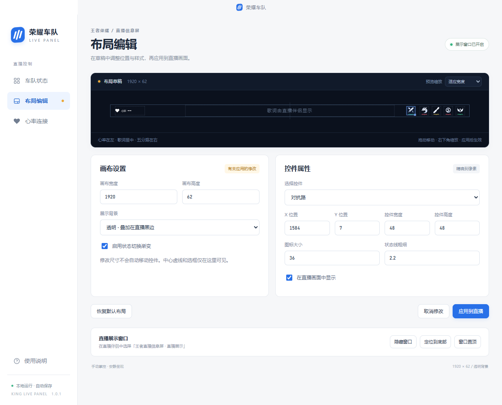
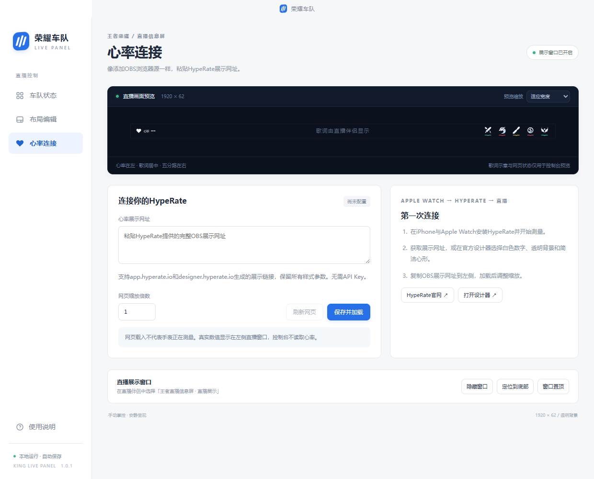

# KingLivePanel · 王者直播信息屏

**KingLivePanel** 是为《王者荣耀》直播设计的 Windows 桌面信息条，使用 Electron、React 和 TypeScript 开发。默认画布为 **1920 × 62**：左侧显示心率网页，中间预留歌词区域，右侧显示五个分路的席位状态。

展示窗口和控制台独立。展示窗口透明、无边框、鼠标穿透；控制台负责切换状态、编辑布局和管理窗口。

## 功能

- 五个分路：对抗路、打野、中路、发育路、游走。
- 每个分路独立选择空位、下局有人、有人，分别显示绿色、黄色、红色状态线。
- 布局支持拖动、缩放、精确数值输入、控件显隐及透明／黑色背景。
- 布局修改先保存在草稿中，点击“应用到直播”后才更新展示窗口。
- 支持 HypeRate 展示网页，提供加载状态、失败重试和手动刷新。开启“仅读取网页数字”后，保留默认白色爱心和心率样式，仅同步网页中的当前数字。
- 配置与网页数据保存在程序旁的 `data/`，支持随整个文件夹迁移。

本程序不检测游戏对局，不自动换局，不抓取歌词，不生成或记录心率历史。

### 车队状态界面

上方预览展示心率、歌词预留区和五分路的位置；下方卡片用于切换席位状态，底部按钮管理直播展示窗口。



本文截图来自实际桌面程序，使用独立临时配置。图中的绿色、黄色、红色席位用于演示三种状态；首次启动仍全部为空位。心率尚未连接，没有模拟真实测量数值。

## 运行便携版

适用环境：Windows 10/11 x64。

1. 找到打包输出的 `KingLivePanel-1.0.2-portable.zip`。
2. 完整解压到可写入的文件夹；如需数据留在非系统盘，请解压到 D 盘、E 盘等位置。
3. 双击 `King Live Panel.exe`。便携版不需要安装 Node.js。
4. 通过控制台配置分路状态、布局和心率。关闭控制台即退出程序。

不要在压缩软件中直接运行 EXE，也不要单独移动 EXE。DLL、`resources/`、`locales/` 和许可证文件属于运行时所需文件，应与程序一并保留。

首次启动时所有分路为空位，心率未配置。之后启动会恢复已保存的分路状态、布局和心率设置。

## 接入直播画面

1. 在直播软件中添加窗口捕获，选择 **王者直播信息屏 · 直播展示**。
2. 对于 1920 × 1080 画布，将来源尺寸设为 1920 × 62，放在 `x=0, y=1018`。
3. 歌词由其他来源提供。默认歌词预留区域为 `x=400–1520`，水平中心为 `x=960`，将歌词来源放在信息屏上方即可。
4. 使用控制台的“显示窗口”“定位到底部”“窗口置顶”管理展示窗口，直播期间保持展示窗口可见。
5. 若捕获后端无法正确显示透明背景，可在布局编辑中切换黑底并应用。

Windows 显示缩放可能带来 1 像素取整差异，最终捕获尺寸以直播软件中的设置为准。实际透明捕获和心率子网页显示效果需要在目标电脑上确认。

## 布局编辑

- 拖动控件移动位置，拖动右下角手柄调整尺寸，也可在属性区输入数值。
- 选中控件后，方向键移动 1 像素，`Shift + 方向键`移动 10 像素。
- 支持适应宽度、100%、150%、200% 预览。
- 可设置画布尺寸、背景、动画、控件显隐、图标大小和状态线粗细。
- 越界会阻止应用，重叠会给出提醒；调整画布尺寸不会自动重排控件。
- “取消修改”恢复已应用的布局；“恢复默认布局”仅重置布局草稿，不清空分路状态和心率设置。

预览中的文字、辅助线、选框和操作按钮不会进入直播输出。



图中已在草稿中调整对抗路的 X 位置，“应用到直播”按钮可用。只有应用后，修改才会同步到直播展示窗口。

## 心率连接

在控制台的“心率连接”中粘贴 HypeRate 的完整 HTTPS 展示网址，点击“保存并加载”。程序支持以下域名，并保留网址查询参数：

- `https://app.hyperate.io/…`
- `https://designer.hyperate.io/…`

请使用展示地址；设计器编辑页不适合作为心率画面。可通过控制台打开 HypeRate 官网或设计器获取组件，再按需要调整网页缩放和心率区域尺寸。

喜欢程序默认的白色爱心时，开启 **“仅读取网页数字”**，再点击“保存并加载”。直播窗口与控制台预览都会显示默认爱心、心率文字和实时数字，不显示网页的图标或背景；未读到有效数字时显示 `--`。此模式无需调整网页缩放，开关会随配置保存。关闭并保存即可恢复原网页样式，旧配置默认保持原网页模式。

仅读取模式需要网页中有可识别的心率文字数字。画布图片、仅图表页面或有多个无法区分的数字时可能无法读取；请使用包含心率数字的展示链接。只同步当前读数，不保存心率历史；若上游网页仍保留掉线前的数字，本程序也会继续显示该数字。

网页在独立沙箱中运行，没有 Node.js 或本地文件访问权限。“网页已载入”只代表加载成功，真实测量、更新频率和停止测量后的显示由 HypeRate 组件决定。端到端测试使用本地模拟网页，不代表已经完成 Apple Watch 实机验证。



在左侧填写展示网址并设置缩放，点击“保存并加载”；右侧提供首次连接步骤和官方网站入口。截图保留未配置状态。

## 数据与备份

正式便携版以 **EXE 所在文件夹**为基准，开发模式以项目目录为基准：

| 路径 | 用途 |
| --- | --- |
| `data/panel-config.json` | 分路状态、布局、心率网址、缩放及仅读取数字开关 |
| `data/cache/` | 网页缓存、Cookie、本地存储及心率网页独立分区 |
| `data/temp/` | 临时文件 |
| `data/app-data/` | 子进程应用数据 |
| `data/logs/`、`data/crash-dumps/` | Electron 日志及崩溃转储路径 |

这些目录在启动时设置，程序不会因启动命令的工作目录不同而改用其他数据位置。目录不可写时会提示并退出。

备份或迁移前先关闭程序，再复制整个程序文件夹，包括 `data/`。配置损坏时会保留带时间戳的原文件副本，再使用默认配置。旧版本的 `%APPDATA%/king-live-panel/panel-config.json` 不会被自动修改；需要迁移时，可在关闭程序后将它复制到新的 `data/panel-config.json`。

运行所需的网页存储及损坏配置备份不属于可随意删除的调试记录。

## 本地开发

使用 Windows x64 和 Node.js 24.12 或以上版本；依赖版本由 `package-lock.json` 锁定。

项目文件夹名称为 `KingLivePanel`。从项目父目录进入文件夹后安装依赖：

```powershell
cd KingLivePanel
npm ci
```

开发与构建：

```powershell
npm run dev
npm run build
npm start
```

| 命令 | 说明 |
| --- | --- |
| `npm run dev` | 启动 Vite 和 Electron，前端支持热更新 |
| `npm run build` | 类型检查、生成图标、构建前端和 Electron 主进程 |
| `npm start` | 运行已经构建的桌面程序 |
| `npm run icons` | 从 SVG 生成 PNG 和包含九档尺寸的 Windows ICO |
| `npm test` | 校验布局、配置迁移、分路状态和心率 URL 边界 |
| `npm run test:e2e` | 在构建后的程序中测试窗口、布局、状态、持久化和心率页面隔离 |
| `npm run test:portable -- "完整 EXE 路径"` | 在发布包的独立副本中验证数据路径、重启和文件夹迁移 |
| `npm run package` | 构建并生成 Windows x64 便携 ZIP |

修改 `electron/` 下的主进程或 preload 后，需要重启开发命令。不要仅在普通浏览器中打开页面来替代桌面程序。

`npm ci` 会重新安装依赖；首次安装或打包可能需要联网下载依赖和打包工具。项目使用 `.npmrc` 将 npm 缓存保存在项目内。

## 打包与文件范围

```powershell
npm run package
```

输出位置：

```text
release/build-时间戳/
├── KingLivePanel-1.0.2-portable.zip
└── win-unpacked/
    ├── King Live Panel.exe
    ├── 使用说明.txt
    └── …Electron 运行时文件
```

请通过 `npm run package` 打包：脚本会读取 Vite 本次构建的资源清单，只收录入口页面、当前 JS/CSS 及资源、应用图标、Electron 主进程与 preload、必要的包信息。依赖已经打入构建文件，不会重复携带应用的 `node_modules/`。旧的哈希资源、测试截图、测试数据、源码映射和构建清单不会进入应用包。

打包使用新的时间戳目录，构建也不会自动批量删除旧文件。历史发布包与构建缓存需按需手动清理。EXE 未配置发布者代码签名。

## 目录结构

```text
KingLivePanel/
├── docs/images/          README 使用的实际界面截图
├── electron/             主进程、窗口、IPC、便携存储与 preload
├── src/                  展示窗口、控制台、布局编辑器及样式
├── shared/model.ts       数据模型、默认值、迁移与校验
├── public/               SVG 源图标及生成的 PNG / ICO
├── scripts/              开发、构建、打包和集成验证脚本
├── tests/                单元测试
├── portable-readme.txt   随发布包提供的简要说明
├── package-lock.json     依赖锁定文件
└── README.md             项目使用与开发说明
```

`.gitignore` 排除依赖、下载缓存、`dist/`、`dist-electron/`、`release/`、`artifacts/`、`.test-data/`、`data/` 以及日志和诊断文件。Git 只保存源码、必要资源、配置、测试及说明文档。

`docs/images/` 中的说明截图随文档提交，不进入桌面程序的发布包。项目目录名为 `KingLivePanel`，当前 Windows 可执行文件名仍为 `King Live Panel.exe`。

测试使用独立的 `.test-data/`；端到端测试的截图和结果写入 `artifacts/`。这些生成目录不属于源代码，也不进入发布包。不要把用户配置或旧发布包提交到仓库。
